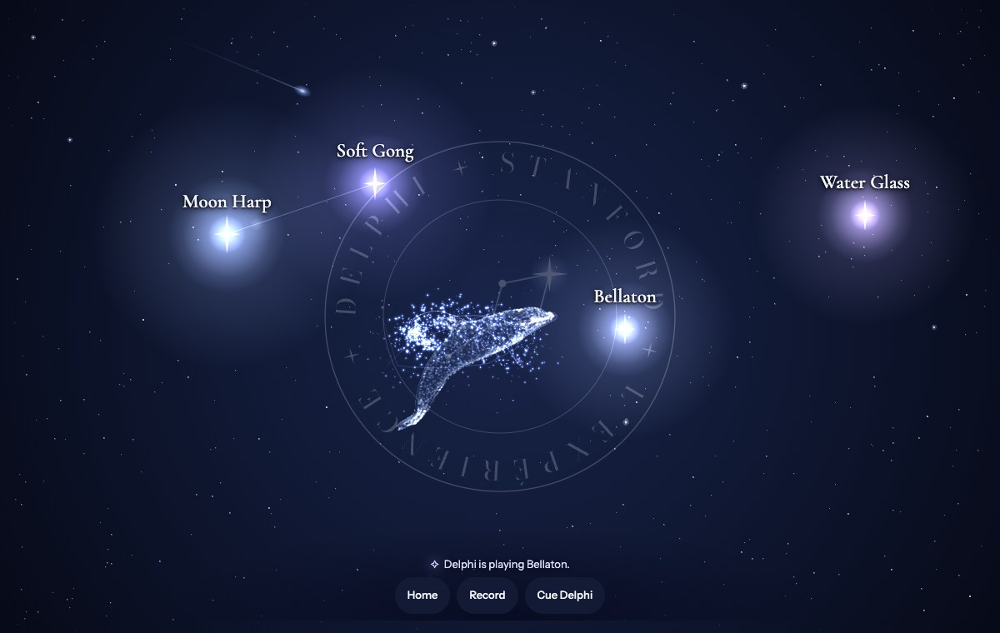
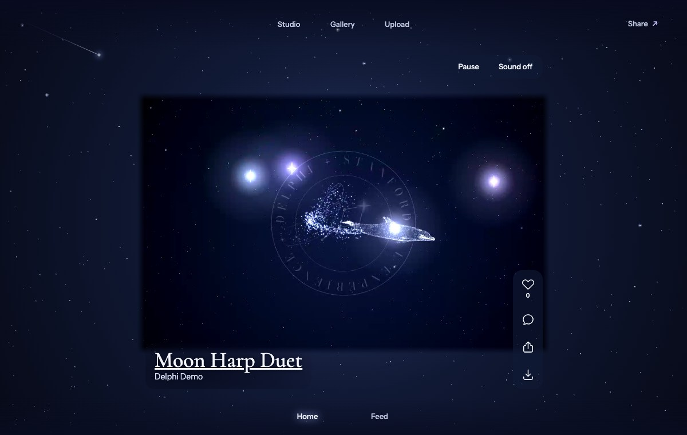

# DELPHI — Play the Stars

### Your hands are the instrument. The universe is your stage.

[Play DELPHI](https://delphi.jayasrisng.com/) · [Explore performances](https://delphi.jayasrisng.com/gallery) · [Upload a clip](https://delphi.jayasrisng.com/upload)



DELPHI is a spatial music playground where you build a constellation by ear and a celestial dolphin plays alongside you. Reach for a star, move it until you find a sound you like, and connect it to another star to hear the shape become a loop.

## Make a constellation

1. **Reach for a star.** Pinch with webcam hand tracking, drag with a mouse, or aim and grab with a WebXR controller.
2. **Shape the sound.** Move up and down through a pentatonic scale or sideways to switch between four instruments.
3. **Connect the stars.** Bring two stars close to preview a link, then release to connect them. A spark travels along the connection as the phrase plays.
4. **Play with Delphi.** Cue the dolphin to echo a phrase, harmonize, add percussion, or play a named instrument.
5. **Capture a take.** Record 30 seconds of the rendered scene and its musical mix, then preview, download, or publish the performance.

## Meet Delphi

Delphinus, the dolphin constellation, inspired the companion. In the Greek story of Arion, music draws a dolphin that rescues the musician. Our team also took inspiration from opera, where musicians communicate expression through posture and gesture. DELPHI asks what those movements might sound like if they could become music themselves.

Delphi swims toward a free star and schedules replies on the Web Audio clock. Type a cue or use voice in a compatible browser. The browser uses on-device English recognition where available and can fall back to the browser speech service. Local accompaniment works without an AI provider.

| Try this cue | What Delphi does |
| --- | --- |
| “Play the drums” | Adds a percussion reply. |
| “Play that back” | Echoes your recent notes. |
| “Harmonize” | Answers with a harmony. |
| “Play Water Glass” | Plays the named instrument. |
| “Alternate Moon Harp and Soft Gong” | Alternates between two instruments. |
| “Play Water Glass every two seconds” | Repeats a note at the requested interval. |

## The sounds of DELPHI

The team explored sounds from Attractor Labs / SATIE. Four sampled instruments power the Studio and Delphi’s replies.

| Instrument | Sound |
| --- | --- |
| Moon Harp | Delicate plucked tones |
| Soft Gong | Resonant percussion |
| Bellaton (Glass Bells) | Bright, shimmering notes |
| Water Glass | Soft, sustained tones |

## Record, share, and discover performances


A desktop Studio take captures 30 seconds of the constellation, dolphin, stardust, and generated audio mix. Preview the result, keep it private with separate video and audio downloads, or publish it to the Gallery.



Browse performances, leave a like or comment, and open a performance page to share or download a take.


You can also upload an MP4, MOV, or WebM with an audio track, including an exported Spectacles clip. Uploads can be up to **50 MB** and **3 minutes**.

## Desktop, WebXR, and Specs

- **Desktop:** Open the Studio and use a mouse or enable webcam hand tracking. Three.js renders the scene, MediaPipe tracks the hands, and Web Audio schedules notes and accompaniment.
- **WebXR:** On a compatible headset browser over HTTPS, use **Enter VR**. Aim and hold the trigger to grab a star, or squeeze the grip to cue drums. Physical headset behavior still needs verification.
- **Snap Spectacles:** The repository includes a rigged dolphin, constellation models, playable stars, a standalone stardust blob, and effects. The starter script supports two-hand pinch, placement, and touch-to-play. The native duet handoff supplies sample banks and hooks for voice, star interaction, and dolphin movement. These are source assets for an existing Lens Studio 5.15.4 project with SIK 0.15.0. Scene wiring and physical Specs testing are still pending.


[Specs import guide](specs/Delphi_Specs_5.15.4/README.md) · [Native duet integration guide](specs/Delphi_Duet_Handoff/INTEGRATION.md) · [Stardust GLB](specs/Delphi_Specs_5.15.4/Models/Stardust_Blob.glb) · [Stardust textures and wiring guide](specs/Delphi_Stardust_Handoff/AGENTS.md)

## Run locally

Install **Node.js 22.13+**, **FFmpeg**, and **FFprobe**.

```sh
git clone https://github.com/jayasrisng/spatial-sonic.git
cd spatial-sonic/web
npm ci
npm run dev -- --port 4177
```

Open [localhost:4177](http://localhost:4177/). Local publishing uses SQLite and disk storage. The hosted app uses Vercel, Supabase, and FFmpeg for uploads and media preparation. See the [web setup guide](web/README.md) for deployment and optional remote accompaniment.

*Some screenshots show the local Studio preview. The hosted interface may differ.*

## What’s next?

We’re exploring live performance, music learning, soundtrack creation, and shared AR composition. We want to see what musicians and first-time players make when they can start with a gesture.
