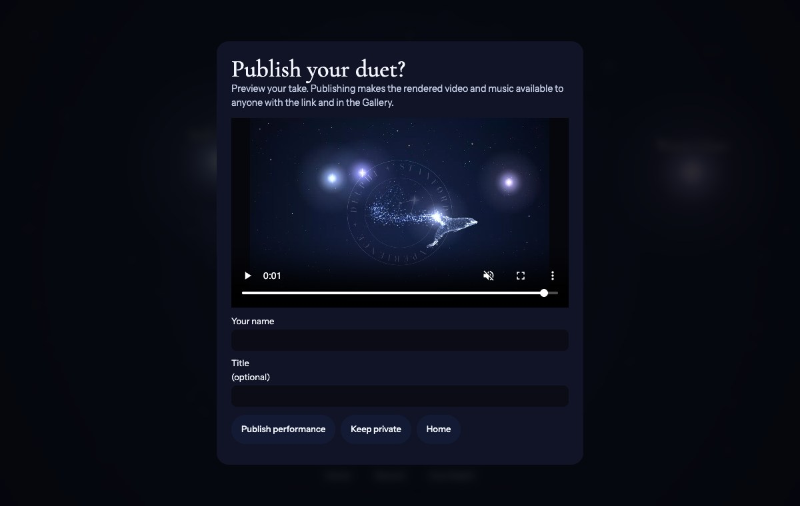
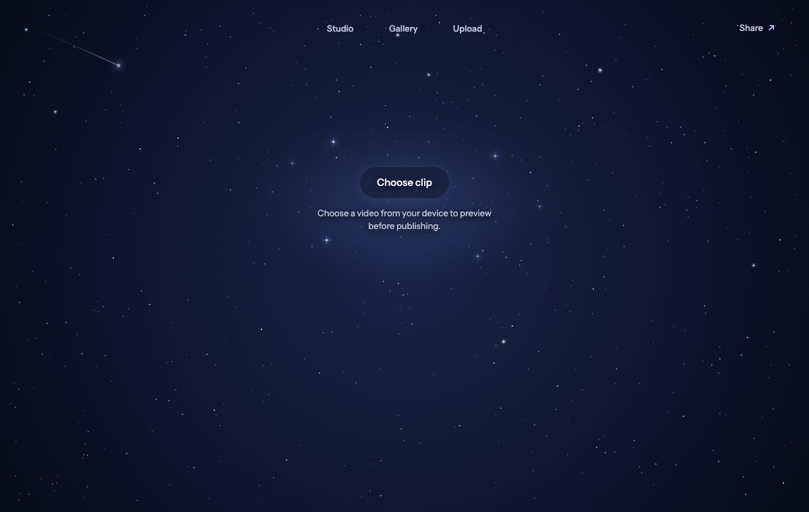
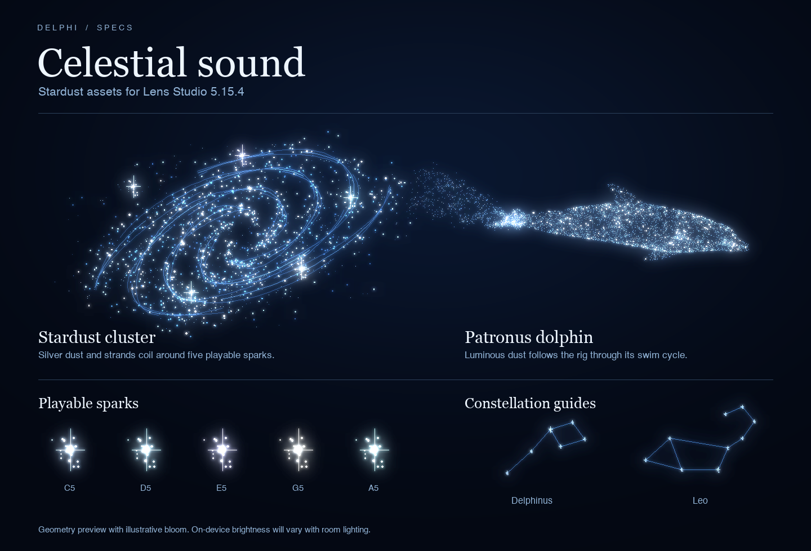

# Delphi · Play the stars

Delphi is a spatial music playground where you build a constellation by ear and a dolphin plays alongside you. We’re building it so making music can start with simple gestures. Grab a star, move it until you find a sound you like, connect it to another star, and hear the shape become a loop. Delphi can answer your phrase, add percussion, or leave space for your solo.

[Play in Studio](https://delphi.jayasrisng.com/) · [Watch performances](https://delphi.jayasrisng.com/gallery) · [Upload a clip](https://delphi.jayasrisng.com/upload)

The screenshots show the local development preview, including SATIE instruments and expanded voice cues. The hosted Studio currently uses the earlier interface. The sample take shown below was recorded in Studio for this README.

## Studio


- **Play by gesture.** Pinch a star with webcam hand tracking, drag it with a mouse, or aim and grab with a WebXR controller. Move vertically through a pentatonic scale and sideways to change instruments. The development preview uses four SATIE sounds in order from left to right: Moon Harp, Soft Gong, Bellaton (Glass Bells), and Water Glass.
- **Turn a shape into a loop.** Bring two stars close to see a dashed link preview. Release to connect them. A spark travels along the connection as the phrase plays, and you can keep moving stars to find new pitches and timbres.
- **Follow the light.** The dolphin swims through a projected field of stars and shooting stars, leaving a trail of particles. Tracked hands appear as stardust, notes pulse at the stars, and Delphi swims toward the star it’s about to play.

## Duet with Delphi

Delphi listens to the notes you play and can echo part of your phrase, harmonize, add a drum accent, or rest. It aims for a free star and schedules its reply on the Web Audio clock so you can keep playing. When configured, the server can suggest automatic replies from recent notes and candidate stars. Local accompaniment works without an AI provider.

The development preview adds named instruments and repeating patterns to **Cue Delphi**. Type a cue, or say it using on-device English recognition on a supported browser.

| Try saying or typing | Delphi’s response |
| --- | --- |
| “Play the drums” | Adds a percussion reply while you play. |
| “Play that back” | Echoes your recent notes. |
| “Harmonize” | Plays a short harmony to your phrase. |
| “Play Water Glass” | Plays the named instrument, even before you’ve played a phrase. |
| “Alternate Moon Harp and Soft Gong” | Switches between two sounds until you stop it. |
| “Play Water Glass every two seconds” | Repeats a note at the requested interval. |

For headset play, open the Studio over HTTPS in a browser that supports immersive WebXR and choose **Enter VR**. Aim at a star, hold the trigger to move it, and squeeze the controller grip to cue drums. Physical headset behavior still needs to be verified.

## Record and share a take



Choose **Record** to make a 30-second take. The development preview hides the interface during the take so the video shows the constellation, the dolphin, and the particles. The recording captures the rendered scene and the generated mix, including Delphi’s replies. Camera frames feed the hand tracker locally, and the voice microphone is used for cues.

Play the take back before deciding what to do with it. **Keep private** offers local video and audio downloads for a Studio take. **Publish performance** adds a title and creator name, creates a shareable performance page, and adds the clip to the Gallery. The site’s **Share** button also opens a constellation QR code that links back to the Studio.

## Gallery and performance pages


**Home** plays performances in a scrolling gallery with playback and sound controls. **Feed** gives you a thumbnail grid with view and like counts. Select a tile to open its player. Every published take has a performance page with its own link, video playback, likes, comments, and separate audio and video downloads. You can share a clip with someone who has never opened the Studio.

## Upload a clip



Use **Upload** to bring in a clip from your device, including a Spectacles recording saved to your phone. Choose an MP4, MOV, or WebM with an audio track, up to **50 MB** and **3 minutes**. Preview it before publishing. Delphi prepares a browser-ready video, a thumbnail, and a separate audio download for the performance page.

## Specs

The Lens Studio source pack includes a rigged, swimming dolphin, playable stars, note samples, constellation models, dust textures, and placement, pulse, and trail effects. The starter scene script supports two-hand pinch, placement, and touch-to-play interactions. The source pack targets **Lens Studio 5.15.4** and **Spectacles Interaction Kit 0.15.0**. A native duet handoff is also in development, with the four SATIE instruments and hooks for voice, star interaction, and dolphin movement. It still needs to be wired into a Lens scene and tested on the glasses.



[Specs import guide](specs/Delphi_Specs_5.15.4/README.md) · [Native duet behavior and timing contract](specs/Dolphin-Duet.md)

## Run locally

Install **Node 22.13+**, **FFmpeg**, and **FFprobe**.

```sh
cd web
npm ci
npm run dev -- --port 4177
```

Open [localhost:4177](http://localhost:4177/) and start with the mouse or camera. Local publishing uses SQLite and disk storage. See the [web setup and deployment guide](web/README.md) for hosted media storage and optional model accompaniment.
